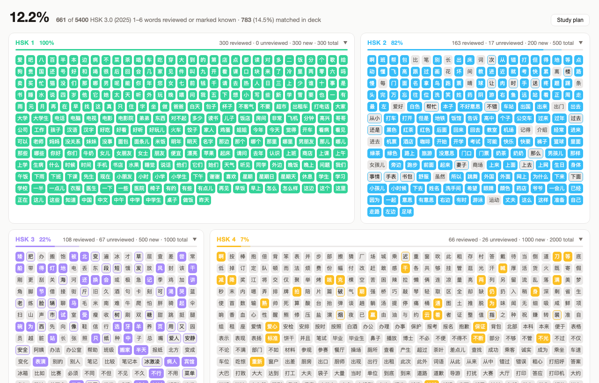
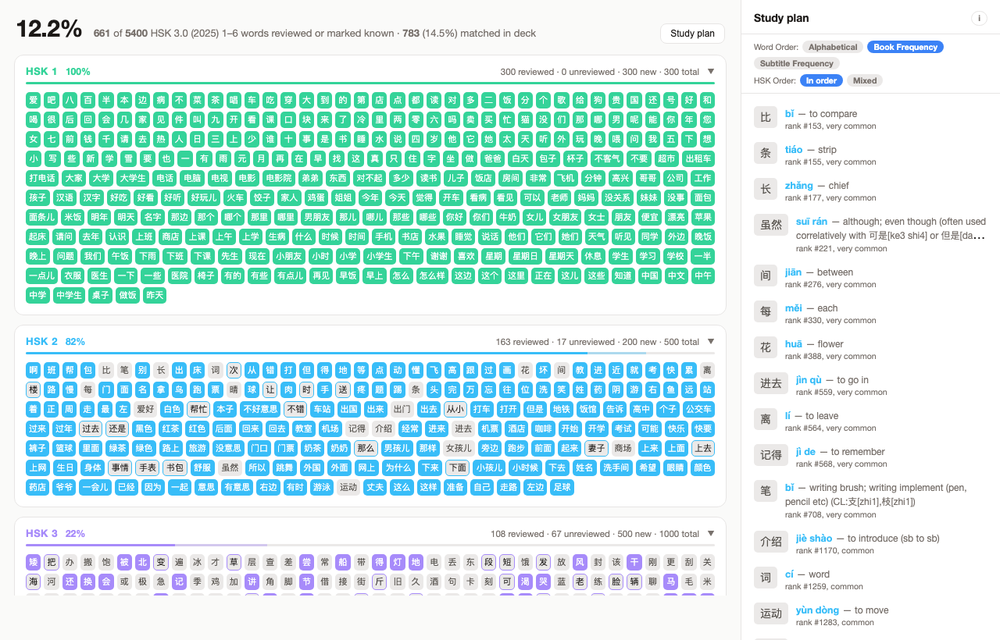

# Anki HSK Coverage Map

An Anki add-on that shows how much of the official HSK vocabulary your deck covers, as a map of hanzi tiles: one tile per word, grouped by level, filled in once you've reviewed it.

Supports HSK 2.0 (2012), HSK 3.0 (2021) and HSK 3.0 (2025, informally "HSK 3.1").

HSK is a trademark of Hanban / Chinese Testing International. This is an independent project, not affiliated with or endorsed by them.

## Install

- **From AnkiWeb:** Tools ▸ Add-ons ▸ Get Add-ons…, enter the code `ANKIWEB_CODE`, restart Anki.
- **From a file:** download `hsk_coverage.ankiaddon` from the [releases](https://github.com/mcgrath-k/anki-hsk-coverage/releases), then Tools ▸ Add-ons ▸ Install from file…, restart Anki.

Requires Anki 2.1.50 or later. On first open the add-on downloads the CC-CEDICT dictionary and two word-frequency lists (about 9 MB in total) and shows the progress; after that everything works offline.

## Use

Open **Tools ▸ HSK Coverage Map**, pick the deck, the note field that holds the Chinese word (for example "Hanzi"), and the word list version. Subdecks are included. A field like `爱 (ài)` still matches 爱, and traditional-character fields match too.

- **Tiles** show one of three states: reviewed or marked known (filled), in your deck but not reviewed yet (outlined), or not in your deck (gray). Panel and headline percentages count reviewed-or-known words only.
- **Click** a tile for pinyin, traditional form, meanings and levels, with a button that opens the matching notes in Anki's browser. ← / → browse words.
- **Right-click** a tile to mark a word you already know without a card. The list lives in a JSON file that Options can move outside the add-on folder so it survives reinstalls.
- **⌘ / Ctrl+F** finds a word and steps through the matches.
- **Study plan** lists every word you don't know yet: alphabetically, or by frequency in books or in film and TV subtitles, level by level or mixed. Add cards with the map open and rows tick themselves off.
- **Options ▸ Export** copies or saves the current list's coverage as JSON, handy for pasting into a chat with an AI for study planning, and exports all your known words across every list as plain text or JSON.

## Reporting problems

Please [open an issue](https://github.com/mcgrath-k/anki-hsk-coverage/issues/new/choose). The Options pane has a **Report a problem…** button that takes you there, and a **Show debug log in folder** button: attaching `debug.log` helps a lot, since it records page errors and, if Anki ever froze, a stack dump of what it was doing. It contains your deck and field names but no card contents.

## Development

The add-on lives in `hsk_coverage/`. `python3 make_anki_addon.py` packages it as `hsk_coverage.ankiaddon` (contents of the folder at the zip root, without `__pycache__`, `meta.json` or `user_files/`).

## Data sources

- HSK vocabulary lists are the official syllabi (Hanban 2012; GF0025-2021; Chinese Testing International 2025) as compiled by Rebecca J. Stone's MteH: https://github.com/becky82/mteh — see `hsk_coverage/data/SOURCES.md`
- Dictionary data (pinyin, meanings, traditional forms) is CC-CEDICT (CC BY-SA 4.0), downloaded once from MDBG on first run: https://www.mdbg.net/chinese/dictionary?page=cc-cedict
- Subtitle frequency: SUBTLEX-CH word frequencies, from Cai, Q. & Brysbaert, M. (2010), "SUBTLEX-CH: Chinese Word and Character Frequencies Based on Film Subtitles", PLoS ONE 5(6): e10729, https://doi.org/10.1371/journal.pone.0010729 (data published with the paper under CC BY; file from https://www.ugent.be/pp/experimentele-psychologie/en/research/documents/subtlexch)
- Book frequency: the literature-channel word list of the BCC corpus (Beijing Language and Culture University), https://bcc.blcu.edu.cn (download centre: free to download and use, citation requested). Cite 荀恩东, 饶高琦, 肖晓悦, 臧娇娇. 大数据背景下BCC语料库的研制. 语料库语言学, 2016, 3(01): 93-109.

## License

Apache License 2.0; see [LICENSE](LICENSE). You may use, modify and redistribute the add-on, including commercially, provided you keep the copyright notice and the [NOTICE](NOTICE) file crediting the original work and mark any changes you make. The data sources above carry their own terms.
